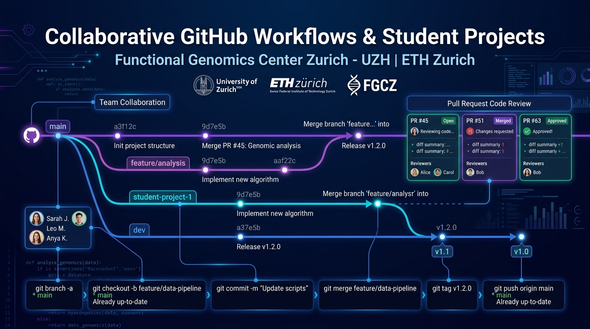

# Collaborative GitHub Workflows & Student Research Projects
## Course Slide Deck & Instructor Lecture Guide



**Host**: Functional Genomics Center Zurich (FGCZ)  
**Institutions**: University of Zurich (UZH) & ETH Zurich  
**Interactive Slide Deck**: [github_groupwork_slides.html](./github_groupwork_slides.html)

---

## Slide 1: Welcome & Framing Collaborative Research

### Slide Content
* **Topic**: Collaborative GitHub Workflows for Group Research Projects
* **The Challenge**: Moving from individual, isolated coding scripts to professional, multi-contributor team repositories.
* **Core Takeaways**:
  1. Setting up a standardized scientific repository layout.
  2. The Feature Branch lifecycle & avoiding the "broken main" trap.
  3. Pull Requests as peer review and scientific quality assurance.
  4. Integrating AI coding assistants seamlessly into Git branches.
  5. The End-of-Course Archival Strategy: Branching & tagging repos for future cohort reference.

> **Instructor Lecture Notes:**
> * Ask students: Have you ever accidentally broken a project right before a deadline, or struggled to merge changes with a group partner over WhatsApp or email?
> * Explain that Git is the worldwide standard for tracking scientific provenance and collaboration in life sciences and bioinformatics.

---

## Slide 2: Why GitHub for Scientific Teamwork?

### The Three Pillars of Modern Computational Science
1. **Single Source of Truth**:
   * Eliminates unversioned archives like `script_final_v2_corrected.py`.
   * Complete commit audit log showing who changed what line of code, when, and why.
2. **Parallel Division of Labor**:
   * Teammate A works on `feature/data-preprocessing`.
   * Teammate B works on `feature/statistical-modeling`.
   * Teammate C works on `feature/interactive-plots`.
   * Neither blocks the other; work progresses concurrently.
3. **Peer Review & Quality Gates**:
   * Pull Requests (PRs) mandate peer code review before integration.
   * Teammates catch bugs, unadjusted p-values, or syntax errors before code lands in `main`.

> **Instructor Lecture Notes:**
> * Frame Git not as a chore, but as an insurance policy for their final course grade and research credibility.

---

## Slide 3: Recommended Repository Anatomy

```
📦 fgcz-course-team-alpha/
├── README.md               # Abstract, experimental hypothesis, CLI quickstart
├── environment.yml         # Conda / Mamba locked environment file
├── .gitignore              # STRICT: ignores raw GB data, caches, .DS_Store
├── data/
│   └── README.md           # External data download links (Zenodo, PRIDE, GEO)
├── src/
│   ├── __init__.py
│   ├── data_loader.py      # Data parsing and QC filtering
│   ├── differential.py     # Statistical testing
│   └── plotting.py         # Volcano, Heatmap, PCA plotting logic
├── notebooks/
│   └── exploratory.ipynb   # Exploratory visual checks
└── tests/
    └── test_stats.py       # Unit tests verifying mathematical outputs
```

### Essential Repository Requirements
* **The "One-Command" Test**: Any student or instructor should be able to clone the repo, install the environment, and run the pipeline with a single command:
  ```bash
  conda env create -f environment.yml
  conda activate bio698-env
  python src/run_pipeline.py
  ```
* **Data Storage Guardrail**: GitHub has a strict 100MB file limit. Raw sequencing files or mass spec raw runs must never be committed to git. Store processed small tables in repo, and document external download links in `data/README.md`.

---

## Slide 4: The Feature Branch Workflow

```
main branch:  ───────●──────────────────────●────────────────────────● (Always Working!)
                     │                      ▲                        ▲
                     │ (git checkout -b)    │ (git merge PR #12)     │ (git merge PR #14)
feat/qc-pipeline:    └───●──────●───────────┘                        │
                                                                     │
feat/volcano-plot:   ────────────────────────────────●───────────────┘
```

### The 4 Step Lifecycle
1. **Branch**: Always create a descriptive branch name from the latest `main`:
   ```bash
   git checkout main
   git pull origin main
   git checkout -b feat/normalization
   ```
2. **Commit**: Make small, self-contained commits with clear conventional commit messages:
   ```bash
   git commit -m "feat: add variance stabilizing transformation to count matrix"
   ```
3. **Pull Request (PR)**: Push the branch to GitHub and open a Pull Request. Request review from at least one group member.
4. **Merge**: Once approved and automated tests pass, merge the PR into `main` and delete the feature branch.

> **Instructor Lecture Notes:**
> * Emphasize rule #1: **Never push directly to `main`**. Main is protected.

---

## Slide 5: Pairing AI Agents with Git Workflows

### How AI Coding Agents (Antigravity / CLI) Supercharge Git
* **Autonomous Branch Work**: You can instruct the agent:
  > *"Create a new branch `feat/gene-enrichment`, implement GO analysis using `clusterProfiler` or `gseapy`, and verify the script runs without errors."*
* **Automatic Clean Diffs**: AI agents write minimal, precise file edits rather than rewriting whole files.
* **Changelogs & PR Descriptions**: The agent can summarize everything it changed into a clear PR markdown summary:
  ```bash
  git status
  git diff --stat
  ```

### Human Review Safeguards
* **Human in the Loop**: Never allow an AI agent to auto-merge into `main`. A human teammate must inspect the diff and verify that results are scientifically valid.
* **Pre-commit Checks**: Verify that the AI didn't create temporary data dumps or hardcoded file paths.

---

## Slide 6: End-of-Course Archival Strategy

### Preserving Student Repositories for Future Years
Instructors often face a dilemma: How to evaluate student group projects, preserve their work as immutable reference benchmarks for future years, and reset template repositories without losing history?

```
Student Project Lifecycle:
[Development on main & branches] ──► [Submission Deadline] ──► [Annotated Git Tag: hs26-final]
                                                                        │
                                                                        ├──► [Cohort Branch: cohort/hs2026]
                                                                        └──► [GitHub Read-Only Archive]
```

### The 3-Step Archival Architecture
1. **Annotated Git Tags (`hs26-final`)**:
   * Creates an immutable, cryptographic pointer to the exact commit submitted at the deadline.
   * Prevents late edits from affecting the grading process.
2. **Cohort Reference Branches (`cohort/hs2026`)**:
   * Allows the instructor to preserve the student cohort's final code on a dedicated branch.
   * `main` can then be cleaned or updated with the starter template for the next year (HS2027).
3. **GitHub Repository Archival**:
   * Navigate to *Settings ➔ Danger Zone ➔ Archive Repository*.
   * Marks the repo as read-only. All commits, Pull Requests, issues, and discussions are preserved forever without any maintenance burden.

---

## Slide 7: Instructor Archival Protocol (Terminal Cheat Sheet)

```bash
# Step 1: Ensure all remote student branches and tags are fetched
git fetch --all --tags

# Step 2: Switch to main branch
git checkout main
git pull origin main

# Step 3: Create an immutable annotated tag for grading
git tag -a hs26-final -m "Evaluated final project submission for HS2026 cohort"
git push origin hs26-final

# Step 4: Branch this state into a permanent cohort archive branch
git checkout -b cohort/hs2026-final hs26-final
git push origin cohort/hs2026-final

# Step 5: (Optional) Prepare template repository for next year (HS2027)
# You can reset main to the pristine starter template without losing HS2026 work:
git checkout -b template-hs27 starter-template-base
git checkout main
git reset --hard starter-template-base
git push origin main --force-with-lease
```

> **Instructor Lecture Notes:**
> * Explain the difference between a branch and a tag: Branches are movable references that continue to evolve; tags are permanent timestamps.

---

## Slide 8: Summary & Team Project Rubric

### Group Evaluation Checklist
- [ ] **Collaborative Balance**: Commits and PRs are distributed across all group members.
- [ ] **Branching Compliance**: Features were developed in isolation and merged through reviewed Pull Requests.
- [ ] **Code Quality & Documentation**: Clear docstrings, comments, and a complete `README.md`.
- [ ] **Computational Reproducibility**: Clean `environment.yml` allowing one-line setup.
- [ ] **Scientific Rigor**: Correct statistical tests, adjusted p-values, and biological interpretation.
- [ ] **Archival Readiness**: Code successfully tagged as `hs26-final` for the course archives.

---

## Interactive Presentation Link
To present this deck interactively in your browser or inside the IDE preview:
* Open [`github_groupwork_slides.html`](./github_groupwork_slides.html)
* Press **Space** or **→** to advance slides.
* Press **N** to toggle Instructor Notes!
