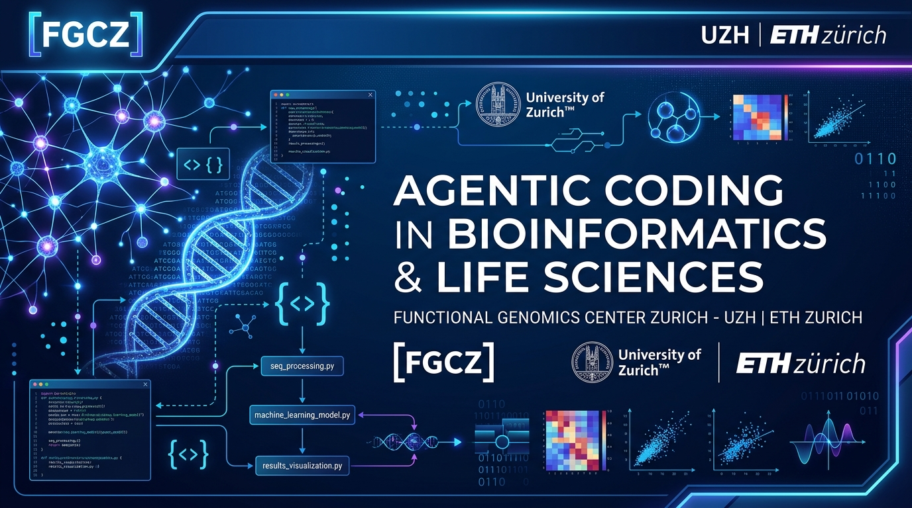

# Agentic Coding in Life Sciences & Higher Education
## Course Slide Deck & Instructor Lecture Guide



**Host**: Functional Genomics Center Zurich (FGCZ)  
**Institutions**: University of Zurich (UZH) & ETH Zurich  
**Interactive Web Deck**: [agentic_coding_slides.html](./agentic_coding_slides.html)

---

## Slide 1: Welcome & Framing the Problem

### Slide Content
* **Topic**: Agentic Coding in Higher Education & Life Sciences
* **The Reality Check**:
  * Instructors often have paid pro tiers (Gemini Pro, Claude Pro/Team).
  * Students cannot be expected to purchase paid subscriptions.
  * Can we deliver a rigorous, hands-on agentic coding curriculum completely **for free**?
* **Core Takeaways Today**:
  1. Where free tools like **Google Antigravity** succeed and where they hit limits.
  2. Why **Claude Code** is not a zero-cost option for students.
  3. Understanding the token economics: $1\text{M}$–$2\text{M}$ context vs. $200\text{k}$ tokens.
  4. Quota architectures (weekly caps vs. 5-hour rolling windows).
  5. Practical context hygiene and free failsafe backups (Google AI Studio).

> **Instructor Lecture Notes:**
> * Open by polling the class: How many students have used ChatGPT or GitHub Copilot? How many have used autonomous agents like Claude Code, Antigravity, Aider, or Roo Code?
> * Clarify that the shift to *agentic* software development requires a fundamental rethink of computing costs, context management, and rate limits.

---

## Slide 2: The Agentic Coding Spectrum

```
Level 1: Chatbot           Level 2: Copilot             Level 3: Autonomous Agent
┌────────────────────┐     ┌──────────────────────┐     ┌───────────────────────────────────┐
│ Web Browser Chat   │     │ Inline Autocomplete  │     │ Environment-Grounded Loop         │
│ • Copy & paste     │ ──> │ • Ghost-text (Tab)   │ ──> │ • Reads file trees & inspects AST │
│ • Disconnected     │     │ • Passive single-line│     │ • Executes shell / tests          │
│ • No tool access   │     │ • Local context only │     │ • Generates git diffs & loops     │
└────────────────────┘     └──────────────────────┘     └───────────────────────────────────┘
```

### Key Differences
| Dimension | Chatbot (1.0) | Copilot (2.0) | Agentic Assistant (3.0) |
| :--- | :--- | :--- | :--- |
| **Execution** | Manual by human | Tab-completion | Autonomous loop (Tool-calling) |
| **Feedback Loop** | Human copies error back | Human accepts/rejects | Agent inspects terminal output & fixes |
| **Token Consumption** | Low ($\approx 1\text{k}$–$4\text{k}$ per prompt) | Low ($\approx 500$ tokens/trigger) | **Extremely High** ($50\text{k}$–$500\text{k}$ per multi-turn task) |

> **Instructor Lecture Notes:**
> * Highlight the feedback loop: in Level 3, the model reads the compiler or test error directly from the shell, generates a diff, edits the file, and runs the test again.
> * Explain to students that *this autonomous looping* is why agentic coding burns tokens exponentially faster than standard chat.

---

## Slide 3: Tool Landscape Reality: Antigravity vs. Claude Code

```
┌──────────────────────────────────────────────┐    ┌──────────────────────────────────────────────┐
│             Google Antigravity               │    │                 Claude Code                  │
├──────────────────────────────────────────────┤    ├──────────────────────────────────────────────┤
│  ✓ Free Individual Tier ($0)                 │    │  ✗ NO Free Tier Available                    │
│  ✓ Sign in with any Google account           │    │  ✗ Requires Claude Pro ($20/mo) or API keys  │
│  ✓ Weekly autonomous agent loop allowance    │    │  ✗ Web free account does NOT grant CLI agent │
│  ✓ Unlimited inline completions & commands   │    │  ✓ Exceptional deep reasoning (Sonnet/Opus)  │
│  ✓ Integrated GUI, terminal, & subagents     │    │  ✓ Powerful prompt-caching architecture      │
│  ★ Recommended for Zero-Cost Student Labs    │    │  ★ Ideal for Instructor / Enterprise use     │
└──────────────────────────────────────────────┘    └──────────────────────────────────────────────┘
```

### The Claude Code Reality Check
* **Common Student Misconception:** *"Claude is free on the web, so Claude Code in my terminal is free."*
* **The Reality:** Running `claude` in the CLI requires an active Anthropic Console API credit balance or a Claude Pro/Team plan. 
* **If an instructor wants Claude in class:** The instructor must create an Anthropic Workspace organization and fund API keys with strict spending caps (\$5–\$10/student).

> **Instructor Lecture Notes:**
> * Direct students away from trying to set up Claude Code unless they already own a personal Claude Pro subscription.
> * Position **Google Antigravity** as the designated, zero-cost, out-of-the-box platform for all lab exercises.

---

## Slide 4: Token Economics & Context Windows

### Visual Comparison of Context Capacity
```
Gemini (Antigravity Pro / API): [████████████████████████████████████████] 1,000,000 – 2,000,000 tokens
Claude (Sonnet / Pro / Team):   [█████                                   ] 200,000 tokens
Standard Chat Web Limits:      [█                                       ] 16,000 – 32,000 tokens
```

### How Much Fits into Context?
* **$200{,}000$ Tokens (Claude):**
  * $\approx 150{,}000$ words or $\approx 500$ printed pages.
  * Easily holds a 15-file Python package, test suite, and active error log.
* **$1{,}000{,}000$–$2{,}000{,}000$ Tokens (Gemini / Antigravity):**
  * $\approx 1{,}500{,}000$ words or $\approx 3{,}000$ pages.
  * Can ingest entire bioinformatics pipelines (e.g., Nextflow workflows, full R/Bioconductor package codebases, and multiple PDF literature papers simultaneously).

### Capacity vs. Rate Limits (The Free Tier Catch)
* **Capacity $\neq$ Velocity**: While Gemini models support millions of tokens, free accounts are governed by **Tokens-Per-Minute (TPM)** and **Requests-Per-Minute (RPM)** caps.
* Ingesting 500k tokens at once on a free account can trigger a rate-limit pause until the minute window clears.

> **Instructor Lecture Notes:**
> * Explain the concept of *Prompt Caching*: Claude discounts cached context by 90% after the first turn; Gemini similarly optimizes repeated prefix tokens.
> * Warn students: Do not dump giant raw biological data files (FASTQ, BAM, mzML) into the agent's context.

---

## Slide 5: Quota Architectures: Paid Subscriptions vs. Free Tiers

| Architecture Feature | Free Individual Plan (Student) | Antigravity Pro / Ultra (Paid) | Claude Pro / Team (Paid) |
| :--- | :--- | :--- | :--- |
| **Refresh Window** | **Weekly Reset** | **5-Hour Rolling** + Weekly High Cap | **5-Hour Rolling Window** |
| **Agent Loops / Day** | Modest budget for weekly labs | $5\times$ to $20\times$ higher allowance | $\approx 40$–$80$ interactions per 5 hours |
| **Default Models** | Flash / lightweight models | Gemini Pro / Deep Thinking | Claude 3.5 Sonnet / 3.7 / Opus |
| **Inline Completions** | Unlimited | Unlimited | N/A (CLI tool only) |
| **When Quota Exhausts** | Agent actions stop until next week | Fall back to metered AI credits | Wait 1–3 hours for next window |

> **Instructor Lecture Notes:**
> * Explain why the refresh window is the most critical pedagogical difference:
>   * A 5-hour rolling window forgives mistakes (an instructor can run out of quota in the morning and have full quota by 2 PM).
>   * A weekly cap penalizes trial-and-error if the student burns it all in one sitting.
> * This leads directly to the **Student Survival Rules** on the next slide.

---

## Slide 6: Student Survival Guide: 4 Golden Rules for Free Tier

### 1. Strict Context Hygiene with `.gitignore`
Before invoking an agent, ensure large directories are excluded:
```gitignore
# Always exclude these from agent indexing!
node_modules/
.venv/
__pycache__/
dist/
*.fastq.gz
*.bam
*.mzML
*.h5ad
```

### 2. Precise File Scoping (No "Fix Everything" Prompts)
* ❌ **Bad Prompt:** *"Look at my whole bioinformatics pipeline and fix the error."*
  * *Result:* The agent searches 50 files, dumps 120k tokens into context, and consumes 25% of the weekly quota.
*  **Good Prompt:** *"In `scripts/normalize_counts.py`, check lines 40–80 where `ZeroDivisionError` occurs in the log-fold calculation."*
  * *Result:* Fast, clean 2k-token edit that preserves quota.

### 3. Flash First, Pro Second
* Use **Flash models** for initial scaffolding, unit testing, and boilerplate.
* Switch to **Pro / Thinking models** only when algorithmic logic or complex debugging fails.

### 4. Rely on Unlimited Inline Completions
* Tab-completions and single-line instructions do not deduct from your autonomous agent quota. Use them for standard coding tasks.

---

## Slide 7: The Failsafe: Google AI Studio Free API Keys

### When a Student Runs Out of Weekly Quota Before a Deadline:
Every student with a Google account can generate a free Gemini API key in 30 seconds at [aistudio.google.com](https://aistudio.google.com):

```
                        ┌─────────────────────────────────┐
                        │   Google AI Studio Free Tier    │
                        ├─────────────────────────────────┤
                        │ • 15 RPM  (Requests / minute)   │
                        │ • 1,000,000 TPM (Tokens / min)  │
                        │ • 1,500 RPD (Requests / day)    │
                        │ • 100% Free - No Credit Card    │
                        └─────────────────────────────────┘
                                         │
                   ┌─────────────────────┴─────────────────────┐
                   ▼                                           ▼
       ┌────────────────────────┐                 ┌────────────────────────┐
       │   Aider CLI (Terminal) │                 │  Continue.dev / Roo    │
       │   $ export GEMINI_API_KEY              │  VS Code Extension     │
       └────────────────────────┘                 └────────────────────────┘
```

> **Instructor Lecture Notes:**
> * Point out that 1,500 requests per day on Google AI Studio is more than enough for any university assignment.
> * Demonstrating this setup provides students with a lifelong, free local development environment.

---

## Slide 8: Course Setup & Recommended Action Plan

### Student Checklist (Day 1)
- [ ] Install **Antigravity** and sign in using a standard Google account.
- [ ] Verify that model selection defaults to **Flash (Fast / Lightweight)**.
- [ ] Initialize repository with a comprehensive `.gitignore`.
- [ ] Bookmark [Google AI Studio](https://aistudio.google.com) as a personal backup API key source.

### Instructor Checklist
- [ ] Complete assignments on a **free test account** beforehand to ensure exercises stay comfortably within the weekly quota.
- [ ] Chunk course projects into 3 discrete milestones (e.g., Week 1: Data parsing; Week 2: Analysis algorithms; Week 3: Visualization & CLI).
- [ ] Provide students with starter code and well-defined unit test suites so agents have clear pass/fail signals.

---

## Interactive Presentation Link
To present this deck interactively in your browser or directly inside the Antigravity IDE preview:
* Open [`agentic_coding_slides.html`](file:///Users/jonasgrossmann/.gemini/antigravity/brain/2561fff1-6f0f-46b9-ae5f-c3f7fe472b34/agentic_coding_slides.html)
* Press **Space** or **→** to advance slides.
* Press **N** or click **Speaker Notes** in the top-right corner to toggle talking points!
